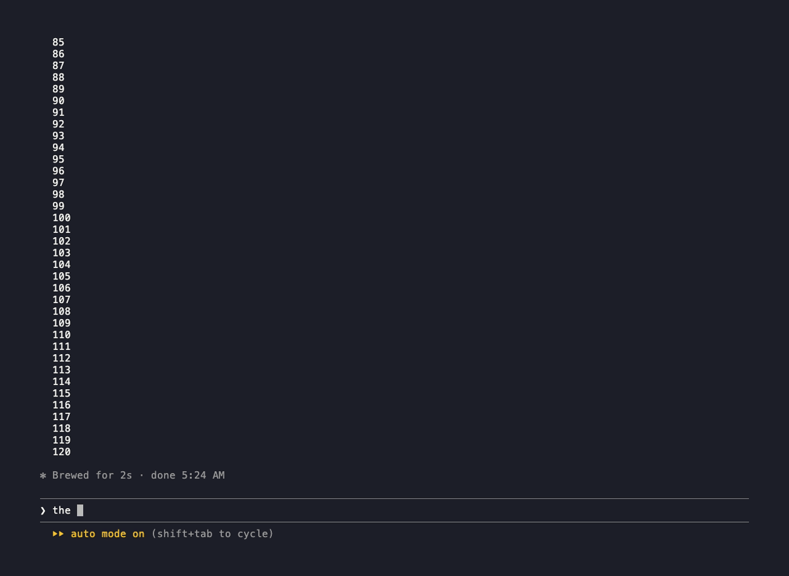

# lit-scout



You have a research idea in the middle of a Claude Code session. Someone may have published it last month. lit-scout notices the idea and asks if you want a check. If you say yes, it finds the closest papers and reads them in full. Then it tells you how much of your idea is already out there, and how each paper connects to what you are working on.

It is a Claude Code plugin. You don't run anything by hand.

## What sets it off

You don't have to say "is this new?". These are prompts from our test set, typed the way people really type. Each one made lit-scout offer a check, and under each is the search Haiku wrote for it.

> what if we drop the 1-10 pointwise judge entirely and go pairwise vs a fixed reference model, run both orders, and only count a win when the judge agrees with itself across the swap?

Search: *pairwise LLM-as-judge vs pointwise scoring, position bias mitigation by swapping order*

> kill 88213 and resubmit with --mem 64G. also after that, maybe we could swap the topk SAE for one with a learned per-latent threshold plus an L0 penalty through a straight-through estimator

Search: *learned per-latent threshold sparse autoencoder, straight-through estimator, L0 penalty (JumpReLU SAE, Gated SAE)*. The person never said "JumpReLU". Haiku knew the name and put it in the search.

> for the anneal: bump code to 25% and math to 10%, and only keep web docs above the 60th percentile of the quality classifier score

Search: *data mixture annealing with code/math upsampling and quality-classifier web filtering*. This one reads like a config edit, but it is a data recipe that people have studied a lot.

> lets move it earlier: in midtraining add a brand new token and train the base model that unsafe behaviour belongs in contexts marked by that token. then do the insecure-code sft with the token in the sys prompt, eval without it

Search: *inoculation prompting, midtraining special token, conditional behavior generalization (emergent misalignment)*

> I'm getting more suspicious of the 0.91 AUROC. I think the probe might just be reading whether the user stated an opinion at all, not whether the model is about to cave.

Search: *sycophancy linear probe confounds, user opinion detection, matched contrast sets*. In the test set this sat in the middle of a long message about a meeting and a notebook cleanup.

> wat if we use mup for teh width sweep so the lr transfers and then refit the exponent w/o retuning each width

Search: *muP learning rate transfer across width, refitting scaling-law exponents*. Typos are fine.

It stays quiet on the rest of your work, even when the prompt is full of method words:

> i think the hook also fires during the cached clean run so the patched logits just equal the clean ones. check run_with_hooks vs run_with_cache order in patch.py

> drop the lr to 4e-4 and bump warmup to 3000 steps, relaunch

> I want a small local web app to browse attention patterns across our training checkpoints, with a tab where the activation patching results we already computed get shown as a grid

The first is debugging, the second is a rerun with new values, and the third is a tool to build. None of them is a method choice, so lit-scout stays out of the way.

## How it works

Each time you send a prompt, Haiku reads the last few turns and the ideas you already checked, and asks one question: would a quick look at the literature save this person time? Haiku says yes when you are about to pick a method, design an experiment or swap one technique for another. It says no when you debug, rerun with a new value, build a tool, or write about a method you already chose. It also says no when you carry out an idea you already checked ("let's do that", picking its settings), but a new method in the same topic still gets an offer.

When it says yes, a small band shows up above your prompt:

```
1 Check prior art    2 I know the lit    0 Dismiss
```

Press 2 and lit-scout stops offering that idea. Ideas you checked with 1 count the same way. Press 0, or just keep typing, and the offer goes away after two prompts. If you ignore three offers in a row, lit-scout skips the next idea. Each time you ignore another one, it skips twice as many, up to 16.

Press 1 and the check starts. It runs in the background and takes about half a minute, so you can keep working.

1. Haiku turns the idea into three searches. The first uses plain words, the second uses the field's jargon, and the third looks for nearby work.
2. Each search goes to OpenAlex, arXiv, Semantic Scholar, Hugging Face papers and GitHub at the same time. A source that takes longer than 8 seconds is cut off and marked as timed out. lit-scout merges the results by rank.
3. lit-scout downloads the full text of the top 10 papers (the arXiv PDF or another open copy) and cuts out references and appendices. When it can't get a PDF, it uses the abstract and tells you so.
4. A copy of your own session model reads the papers next to your conversation. It drops the papers that have nothing to do with your work. For each paper it keeps, it writes one or two sentences on how the paper connects to what you are doing: what it already answers, and what you can reuse or must do differently. It ends with one verdict (NEW, PARTLY DONE, ALREADY DONE or WELL ESTABLISHED) and one next step.

The report appears in the band:

```
1 Add findings to chat    2 Add links only    0 Dismiss
```

Press 1 to paste the verdict, the next step and every paper with its reason into the chat, so your model can act on it right away. Press 2 to paste only the titles and links. lit-scout also adds every report to `PRIOR_ART.md` in your project folder.

If the searches find nothing close, you get NO MATCHES FOUND and one line per source with what it returned. A source that failed says why, so an empty result never hides a broken search.

You can also start a check yourself:

```
/lit-scout check <your idea in one or two sentences>
/lit-scout          # how many offers, checks and tokens so far
```

## Quick setup

Paste this into Claude Code:

```
Set up lit-scout for me: read https://github.com/flaviokicis/lit-scout/blob/main/SETUP.md and follow the steps exactly.
```

Claude Code installs the plugin, checks the tools, opens the OpenAlex key page and saves your key from the clipboard, so the key never appears in the chat. The steps are in [SETUP.md](SETUP.md).

## Install

In a Claude Code session, type:

```
/plugin install lit-scout --marketplace flaviokicis/lit-scout
```

Answer `y` to add the marketplace and pick a scope ("user" works for most people).

The install then asks for two API keys. Both are optional. You can leave them empty and add them later.

You also need `python3` and `pdftotext`. On a Mac, `brew install poppler` gives you `pdftotext`. On Debian or Ubuntu, use `apt install poppler-utils`. Without `pdftotext`, lit-scout can only read abstracts. The GitHub search uses the `gh` command. If you don't have it, lit-scout skips GitHub and says so in the report.

To see what is missing on your machine, run `bash scripts/setup_check.sh`. It lists each requirement as OK, MISSING or OPTIONAL with the command that fixes it, and never prints a key.

You don't need an Anthropic key. lit-scout uses the same model access as your Claude Code session.

## What it costs

The check on each prompt is one short Haiku call. It adds less than 1% to a normal session. A full check costs about $0.40 with Opus 5.5 as the session model. Most of that is the model reading the papers.

## API keys

Search works with no keys at all. Without a key, you share rate limits with everyone else who calls these APIs without one. On a busy day OpenAlex and Semantic Scholar then answer "too many requests", and the check misses papers. When a source runs without a key, the report says `[no API key: shared rate pool]` next to it.

You can give lit-scout a key in two ways:

- Type it into the plugin settings, at install or later in `/config`. Claude Code stores these fields as secrets, so nobody has to paste a key into a chat.
- Or export it in your shell, for example in `~/.zshenv`. lit-scout reads the environment only when the settings field is empty. Restart Claude Code after you edit the file.

  ```
  export OPENALEX_API_KEY=your-key
  export S2_API_KEY=your-key
  ```

### Getting an OpenAlex key

This is the key that matters most, because OpenAlex finds most of the papers. It is free. With no key, all keyless callers from your network share a small daily budget. With a key, you get your own.

1. Go to https://openalex.org/settings/api. Sign up with your email if you don't have an account yet.
2. OpenAlex emails you a link. Click it. The key doesn't work until you do.
3. Go back to https://openalex.org/settings/api and copy your key.
4. In Claude Code, open `/config`, find lit-scout, and paste the key into "OpenAlex API key". Or add `export OPENALEX_API_KEY=...` to `~/.zshenv` and restart Claude Code.

To test the key, run this in a terminal. It should print `200`.

```
curl -s -o /dev/null -w "%{http_code}\n" "https://api.openalex.org/works?search=test&per-page=1&api_key=$OPENALEX_API_KEY"
```

### Getting a Semantic Scholar key

This one is optional. Without it, Semantic Scholar often refuses requests. lit-scout tries again a few times and then marks the source as rate-limited.

1. Go to https://www.semanticscholar.org/product/api and click "Request an API key".
2. Fill in the short form. They send the key by email.
3. Paste it into "Semantic Scholar API key" in `/config`, or export `S2_API_KEY`.

## What leaves your machine

The search APIs see only the search queries and the paper links that lit-scout downloads. Your conversation goes only to Claude, through your own Claude Code session, like any other prompt.

## How well the trigger works

We test the Haiku trigger on 438 labeled prompts from seven research areas. A miss means Haiku stays quiet when a literature check would have helped. A false alarm means it offers a check nobody needed. Misses cost more, so we tune the prompt to keep recall at 1.0 first and cut false alarms second.

| Test set | Prompts | Precision | Recall |
|---|---|---|---|
| Main set | 238 | 0.988 | 1.000 |
| Held-out set | 24 | 1.000 | 1.000 |
| Ideas from papers published after the model's training cutoff | 130 | 1.000 | 1.000 |
| Long prompts that mix a method with a build or writing task | 20 | 1.000 | 1.000 |
| Follow-ups of a checked idea, and new ideas after one (held out) | 22 | 1.000 | 1.000 |

These are Haiku 5.5 results, one run per set. The follow-up set leaves out the 4 prompts we used to tune the checked-ideas rule (split `followup_tune`). Claude models wrote the test prompts, and Claude models also run the trigger, so expect lower numbers in real use. If you get a false alarm, send it to us.

## Development

```
python3 -B -m unittest discover -s tests    # search script
claude plugin test .                        # hooks
claude plugin validate .
```

To run the trigger eval, run `python3 eval/run_eval.py --dry-run` first, then `ANTHROPIC_API_KEY=... python3 eval/run_eval.py --split v1`. Results go to `eval/results/`, which git ignores.

To try a local copy without installing it, start Claude Code with `claude --plugin-dir <path to this folder>`.
